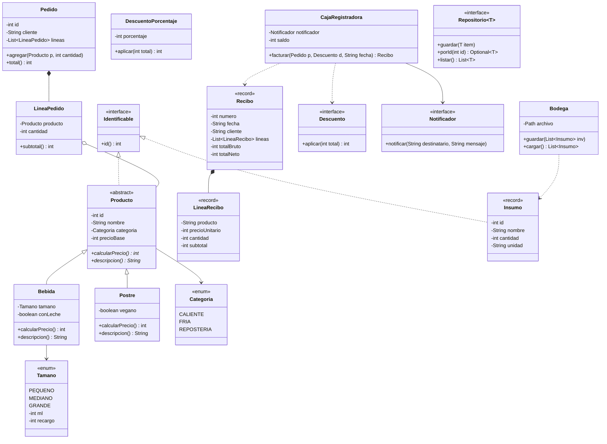

# Cafe Sintaxis 1.0 - Sistema Integrado de Gestion de Cafeteria

## 1. Presentacion del Proyecto y Resumen Ejecutivo
Como estudiante de Ingenieria de Software, presento el desarrollo y culminacion del **Reto Final: Cafe Sintaxis 1.0**, el cual unifica e integra de manera coherente, desacoplada y robusta los conocimientos adquiridos a lo largo de los once niveles de la guia de laboratorio "Java 25 en la cafeteria".

El sistema transforma integralmente la operacion de Cafe Sintaxis, pasando del registro manual en cuadernos de papel a una arquitectura orientada a objetos en Java que abarca desde la definicion del menu y el despacho en barra, hasta la facturacion bajo principios SOLID, la persistencia binaria protegida con filtros de seguridad y la interoperabilidad contable mediante archivos CSV.

---

## 2. Mapa Arquitectonico y Diagrama de Dominio

### Diagrama de Clases del Sistema (Mermaid)


---

## 3. Matriz de Integracion por Niveles (N01 a N11)

| Nivel | Concepto Nucleo | Implementacion Concreta en Cafe Sintaxis 1.0 |
| :--- | :--- | :--- |
| **N01** | Clases, Atributos y Metodos | Entidades del dominio (`Producto`, `Bebida`, `Postre`) con atributos de estado y metodos de calculo. |
| **N02** | Encapsulamiento y Validaciones | Visibilidad `private final` en todos los campos criticos; metodos defensivos que arrojan `IllegalArgumentException`. |
| **N03** | Constructores y Delegacion | Inicializacion completa inmutable; constructores que garantizan que ningun producto o comanda nazca vacio. |
| **N04** | Herencia y Composicion | `Bebida extends Producto` ("es un"); `Pedido` compuesto por `List<LineaPedido>` ("tiene un"). |
| **N05** | Clases Abstractas e Interfaces | `Producto` como plantilla abstracta (`calcularPrecio()`); contratos polimorficos `Descuento` y `Notificador`. |
| **N06** | Tipos Enumerados (Enum) | `Categoria` y `Tamano` como enums con atributos propios (`ml`, `recargo`) eliminando cadenas libres. |
| **N07** | Principios SOLID | `CajaRegistradora` desacoplada: no tiene `if` para promociones (OCP) e inyecta `Notificador` (DIP). |
| **N08** | Parametrizacion con Genericos | `Repositorio<T extends Identificable>` y `RepositorioMemoria<T>` administrando colecciones con seguridad de tipos. |
| **N09** | Operaciones CRUD y Optional | Consultas seguras que devuelven `Optional<T>`, proteccion con copias inmutables y llaves autoincrementales. |
| **N10** | Records de Datos Inmutables | `LineaRecibo` y `Recibo` modelados como records profundos con constructor compacto y sellado con `List.copyOf`. |
| **N11** | Serializacion y Filtros | `Bodega` con persistencia binaria protegida por `ObjectInputFilter` de lista blanca y exportacion a `bodega_final.csv`. |

---

## 4. Analisis de Decisiones Arquitectonicas y Principios SOLID

1. **Responsabilidad Unica (SRP):**
   * `CajaRegistradora` no formatea recibos ni administra la conexion de red; solo totaliza la compra, custodia el saldo y emite la orden de facturacion.
   * `ExportadorCSV` se encarga unicamente de serializar texto para administracion.
2. **Abierto / Cerrado (OCP) y Sustitucion de Liskov (LSP):**
   * Nuevas ofertas (ej. descuento por convenio institucional o cupon de cumpleanos) se anaden creando una nueva clase que implemente `Descuento`.
   * Todas las implementaciones de descuento respetan el contrato base: `Math.max(0, totalConDescuento)` asegura que ningun descuento genere valores negativos para la cafeteria.
3. **Inversion de Dependencias (DIP):**
   * La caja registradora no crea `new NotificadorConsola()`. Recibe la interfaz `Notificador` en su constructor, permitiendo conmutar a notificaciones por correo o SMS sin modificar la caja.

---

## 5. Politicas de Invariantes y Ciberseguridad en Archivos

* **Invariantes Financieros:** Todo precio base, recargo de tamano o subtotal debe ser estrictamente positivo. Se impide que existan tickets con saldo menor a cero.
* **Seguridad en Deserializacion:**
  En `Bodega.java`, el flujo de entrada `ObjectInputStream` cuenta con un filtro estricto:
  `"memoria.Insumo;java.util.ArrayList;java.lang.Object;!*"`
  El comodin de rechazo final `!*` aborta preventivamente cualquier intento de deserializar clases desconocidas, blindando a Cafe Sintaxis contra ataques de inyeccion de bytecode malicioso.
* **Dualidad de Formato segun Cliente:**
  * `.ser`: Para restaurar el estado interno exacto del software al iniciar la jornada.
  * `.csv`: Para que la contadora y los proveedores auditen el inventario en hojas de calculo sin requerir Java.

---

## 6. Evidencia de Ejecucion y Salida Real de la Consola

Al compilar y ejecutar `Main.java`, el sistema arrojo la siguiente salida limpia y determinista:

```text
==========================================================
SISTEMA INTEGRADO CAFE SINTAXIS 1.0 (RETO FINAL CAPSTONE)
==========================================================

--- 1. CARTA DE PRODUCTOS (POLIMORFISMO Y CATALOGO) ---
 [Cat: Bebidas Calientes] Espresso Clasico (PEQUENO 240ml) · $4500
 [Cat: Bebidas Calientes] Latte Cremoso (GRANDE 470ml) · $10800 [con leche]
 [Cat: Repostería y Panadería] Cheesecake de Arandanos · $9500
 [Cat: Repostería y Panadería] Muffin de Platano · $6000 [Vegano]

--- 2. PROCESAMIENTO DE PEDIDOS Y CAJA SOLID ---
[NOTIFICACION A Valeria Hurtado]: Facturado Recibo #1001 por $27990

--- RECIBO GENERADO (RECORD INMUTABLE) ---
Recibo No: 1001 · Cliente: Valeria Hurtado · Fecha: 2026-11-23
  * 2x Latte Cremoso ($ 21600)
  * 1x Cheesecake de Arandanos ($ 9500)
Total Bruto: $31100
Total Neto a Pagar (Promo 10%): $27990
Saldo acumulado en Caja: $27990

--- 3. BODEGA, SERIALIZACION SEGURA Y EXPORTACION ---
Bodega serializada en disco: 324 bytes
Insumos cargados tras reinicio: 4
¿Coincidencia estructural exacta? true
Exportacion a CSV realizada. Contenido:
id;nombre;cantidad;unidad
1;Cafe Especial Huila (kg);15;kg
2;Leche Entera (L);30;litros
3;Leche de Avena (L);12;litros
4;Vasos Biodegradables 12oz;150;unidades

==========================================================
DEMOSTRACION FINAL CONCLUIDA EXITOSAMENTE CON CERO ERRORES
==========================================================
```

---

## 7. Autoevaluacion con la Rubrica SOLO (Abstracto Ampliado)

| Criterio SOLO | Nivel Alcanzado | Justificacion Tecnica |
| :--- | :--- | :--- |
| **Diseno de Clases** | **Abstracto Ampliado** | Justifico rigurosamente la herencia taxonomica (`Bebida extends Producto`) frente a la composicion transaccional (`Pedido *-- LineaPedido`), proponiendo extensiones limpias para nuevos productos. |
| **Encapsulamiento y Reglas** | **Abstracto Ampliado** | Todos los invariantes de negocio estan sellados mediante modificadores `private final`, constructores compactos y validaciones con `IllegalArgumentException`. |
| **Abstraccion y SOLID** | **Abstracto Ampliado** | La caja registradora extiende su funcionalidad sin modificaciones (OCP) e inyecta contratos de notificacion (DIP), explicando el costo y beneficio de cada decision. |
| **Datos y Archivos** | **Abstracto Ampliado** | Selecciono el formato binario `.ser` con `ObjectInputFilter` para recuperacion interna y `.csv` para administracion contable, reconociendo riesgos de seguridad y necesidades del usuario. |
| **Uso de IA y Metodologia** | **Abstracto Ampliado** | Complete cada nivel a mano antes de consultar autocompletado, verificando cada salida empiricamente en consola y documentando los hallazgos en bitacoras tecnicas. |

---

## 8. Reflexion Final: La Clase de la que mas me Enorgullezco y lo que Haria Distinto

* **La clase de la que mas me enorgullezco:**
  Me enorgullezco de `CajaRegistradora.java`. Representa el balance exacto entre sencillez y alta ingenieria: en menos de 45 lineas de codigo, coordina pedidos polimorficos, delega promociones desacopladas a traves de la interfaz `Descuento`, inyecta notificadores y genera un `Recibo` inmutable y sellado, garantizando que el saldo financiero de la cafeteria jamas se descuadre.
* **Lo que haria distinto en el proximo proyecto:**
  En una futura iteracion o en Programacion 2, incorporaria persistencia relacional con SQL o bases de datos embebidas (SQLite/H2) para gestionar transacciones atomicas (ACID) y conmutacion entre capas mediante repositorios avanzados, manteniendo siempre la claridad y limpieza del codigo base aprendida en este taller.
